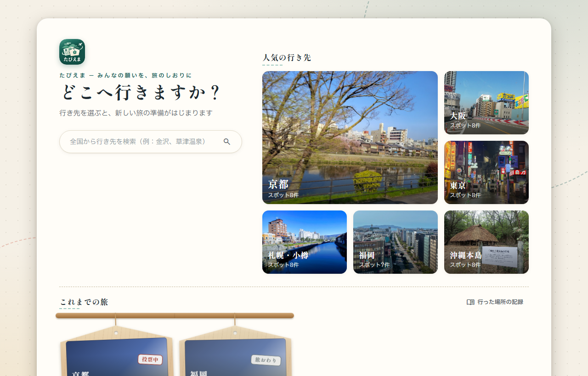
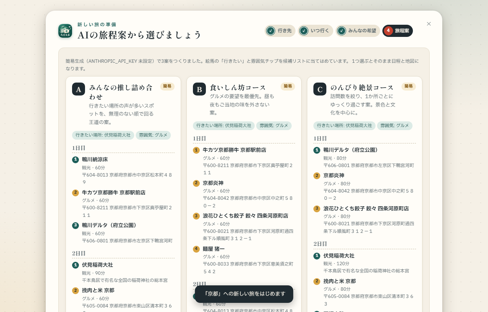
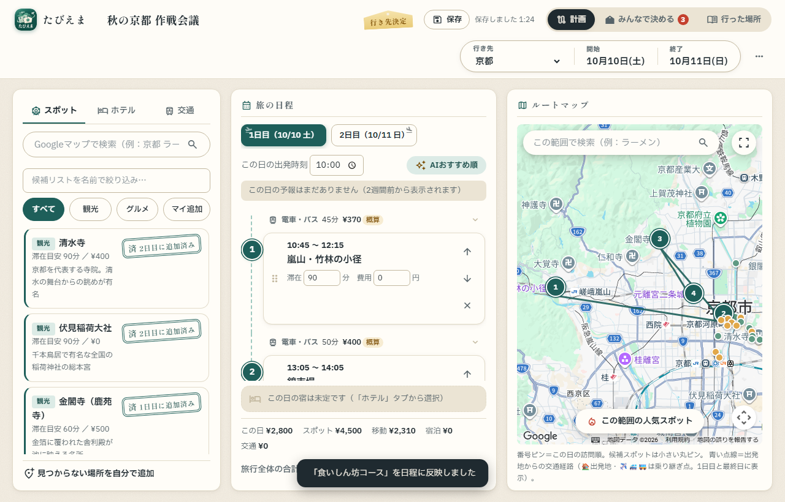
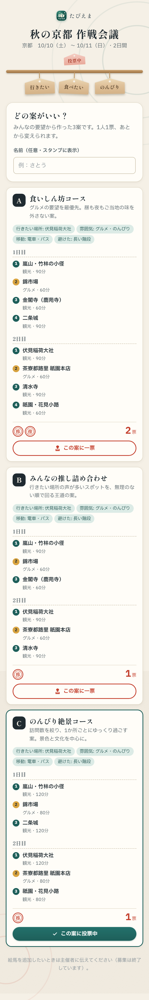
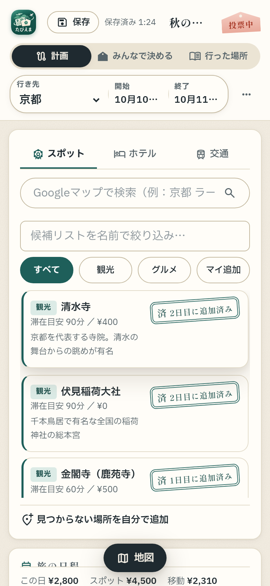

# たびえま — みんなの願いを、旅のしおりに

**仲間の「行きたい」を絵馬として集め、AI が旅程案をつくり、みんなで投票して決めた案がそのまま地図つきの日程になる** 国内旅行プランナーです。



| AI の旅程案（3案から選ぶ） | 計画画面（日程タイムライン＋ルートマップ） |
|---|---|
|  |  |

---

## 目次

- [開発のきっかけ](#開発のきっかけ)
- [「希望の集め方」の作り変え](#希望の集め方の作り変え)
- [主な機能](#主な機能)
- [使い方の流れ](#使い方の流れ)
- [技術スタック](#技術スタック)
- [アーキテクチャ](#アーキテクチャ)
- [設計・実装で工夫した点](#設計実装で工夫した点)
- [開発体制](#開発体制)
- [テスト](#テスト)
- [セットアップ](#セットアップ)
- [ディレクトリ構成](#ディレクトリ構成)
- [既知の制約・今後の課題](#既知の制約今後の課題)

---

## 開発のきっかけ

友人と旅行を計画するとき、いつも次の3つで困っていました。

| 困りごと | たびえまでの解決 |
|---|---|
| **(a) どこに何があるか分からない** | Google Places でのスポット・飲食店・宿の検索と人気スポット表示、天気予報、以前行った場所の履歴DB |
| **(b) みんな行きたいところが多く、まとまらない** | 一人ひとりが登録なしで希望を出せる **絵馬** と、朱印による **投票** |
| **(c) 計画を立てるのが面倒** | 絵馬と候補地から AI が性格の違う旅程案を 3 つ作り、選んだ案がそのまま地図つきの日程になる |

あわせて、進化の速い生成 AI を、実際に使えるアプリの中で自分の手で確かめてみたいという思いもありました。

## 「希望の集め方」の作り変え

「みんなの希望を集めて決める」という目標は、最初から変わっていません。変えたのは、その **手段** です。

- **最初の形**：計画担当（自分）が友人の希望を口頭で聞き、自分で候補に追加する。サーバー・DB なしの静的 Web アプリ（[2026-07 の企画書](docs/新機能企画_2026-07-12.md)）
- **見えた問題**：計画担当の負担が大きい／口頭だと意見を言いにくい／記録に残らない
- **作り変えた形**：一人ひとりが自分のスマホから希望を出せる **絵馬・投票** の仕組みに変え、サーバー（FastAPI）・DB（SQLite）・共有リンクのある構成へ移行

これにより、全員が意見を出しやすくなり、誰が何を望んだかが記録として残るようになりました。

## 主な機能

| 機能 | 内容 |
|---|---|
| 🎴 **絵馬で希望を集める** | 共有リンク／QR コードを配ると、仲間は **登録なし・匿名** でスマホから希望（雰囲気・移動手段・予算・行きたい場所・食べたいもの・避けたいこと）を書ける |
| 🤖 **AI が旅程案を 3 つ提案** | 集まった絵馬と候補地をもとに、Claude API が **性格の違う 3 案**（王道／食いしん坊／のんびり など）を生成。API キーがなくてもルールベースの簡易生成で動く |
| 🗳️ **投票で決める** | 参加者ページで「この案に一票」。票は朱印のスタンプで表示 |
| 🗺️ **地図つきの日程に自動変換** | 選ばれた案がそのまま日程タイムラインと地図ピン・ルート線になる。滞在時間・移動手段から到着時刻と費用を自動計算 |
| 🔎 **スポット・宿の検索** | Google Places で全国の観光地・飲食店・ホテルを検索し候補に追加（評価付き） |
| 🚃 **移動時間と交通費** | Google Routes API で徒歩・車の実所要時間を取得。電車・バスは距離ベースで概算 |
| ☀️ **天気予報** | Open-Meteo から各日の天気を取得し、その日の日程に表示 |
| 📒 **行った場所の記録（履歴DB）** | 旅を終えると訪れた店舗情報が蓄積され、次の旅で再検索せずに候補へ戻せる |
| 📱 **スマホ対応・PWA** | レスポンシブ対応。ホーム画面に追加してアプリのように使える |

<p align="center">
  
  &nbsp;&nbsp;
  
</p>
<p align="center"><sub>左：参加者の投票画面（スマホ）／右：計画画面（スマホ）</sub></p>

## 使い方の流れ

1. **行き先を選ぶ** — 全国検索、または人気の行き先から選ぶと新しい旅のウィザードが始まる
2. **いつ行く？** — 範囲カレンダーで日程を選ぶ（日帰り〜最大16日間）
3. **みんなの希望** — 自分の絵馬を書き、仲間に共有リンク・QR を配る（回答を待たずに先へ進める）
4. **AI の旅程案** — 3 案から 1 つ選ぶと決定。「仲間に投票してもらう」「作り直す」「自分で組む」も選べる
5. **計画画面** — 候補リスト／日程タイムライン／地図の 3 ペインで、並び替え・滞在時間・費用を調整
6. **旅のあと** — 訪れた場所が履歴DBに記録され、次の旅の候補として使える

変更は自動保存され、ホームの「これまでの旅」から何度でも開き直せます。

## 技術スタック

| 区分 | 使用技術 |
|---|---|
| フロントエンド | HTML / CSS / Vanilla JavaScript（フレームワーク・ビルド工程なし） |
| 地図 | Google Maps JavaScript API・Places API (New)・Routes API ／ Leaflet + OpenStreetMap（キー不要のフォールバック） |
| バックエンド | Python / FastAPI / Uvicorn |
| データベース | SQLite |
| AI | Anthropic Claude API（構造化出力 + Pydantic スキーマ） |
| 外部 API | Open-Meteo（天気予報）、segno（QR コード生成） |
| テスト | Node.js（ロジックの単体テスト）、FastAPI TestClient（API テスト）、Playwright（画面の E2E 検証） |

規模：JavaScript / CSS / Python / HTML / テスト合計 約 13,000 行

## アーキテクチャ

```
 ┌──────────── 主催者のブラウザ ────────────┐        ┌──── 参加者のスマホ ────┐
 │ index.html                               │        │ share.html (/s/{token}) │
 │  ├ projects.js  旅の一覧・自動保存        │        │  絵馬の投稿・投票        │
 │  ├ wizard.js    新しい旅のウィザード      │        └───────────┬────────────┘
 │  ├ collab.js    絵馬・AI案・投票・採用    │                    │
 │  ├ app.js       日程・費用・検索UI        │                    │
 │  ├ map.js       地図アダプタ ─────────────┼──▶ Google Maps / Places / Routes
 │  │              (Google / Leaflet 切替)  │      または OpenStreetMap
 │  ├ weather.js ───────────────────────────┼──▶ Open-Meteo
 │  └ api.js       サーバー有無を判定        │
 └──────────────────┬───────────────────────┘                    │
                    │ REST (JSON)                                 │
                    ▼                                             ▼
 ┌─────────────────────────── FastAPI (server/main.py) ───────────────────────────┐
 │  /api/projects  旅の CRUD・計画の保存     /api/s/{token}  参加者用（匿名）        │
 │  /api/projects/{id}/wishes・proposals・vote・qr.svg     /api/history  履歴DB    │
 │                                                                                │
 │  ai.py ── Claude API（構造化出力）──失敗・キーなし──▶ ルールベース生成           │
 │  db.py ── SQLite（projects / wishes / proposals / votes / history_*）           │
 └────────────────────────────────────────────────────────────────────────────────┘
```

## 設計・実装で工夫した点

### 1. 「API キーがなくても全部動く」段階的な機能拡張
外部サービスに依存する機能は、すべて **キーなしで動く代替手段** を用意しました。

- **地図**：`map.js` を Google Maps と Leaflet の共通インターフェースを持つアダプタにし、`CONFIG` の有無で切り替え。キーがなくてもピン・ルート線・位置指定が使える
- **AI**：Claude API が使えない／失敗したときは、絵馬の「行きたい」「食べたいもの」と雰囲気チップで候補地を採点するルールベース生成に自動で切り替え。**どちらも同じ形のデータを返す** ので、フロントエンドは出どころを意識しない
- **サーバー**：`api.js` がサーバーの有無を判定し、`index.html` を直接開いた場合は localStorage に保存する「ローカル保存モード」で計画機能をすべて使える

### 2. LLM の出力を「そのまま使えるデータ」にする
Claude API には Pydantic で定義したスキーマ（日ごとのスポット名・カテゴリ・滞在時間・座標・候補リスト由来かどうか）で **構造化出力** を要求しています。
採用時、候補リストにない場所は AI 案の座標または Google 検索で位置を補い、自作スポットとして日程に組み込みます。自由文の提案ではなく、すぐ地図と日程に変換できる形にしました。

### 3. 参加のハードルを下げる共有設計
参加者はアカウント登録不要。共有トークン付きの URL（QR コードでも配布）を開くだけで絵馬を書き、投票できます。投票は 1 端末 1 票で、あとから変更可能です。

### 4. コンセプトのあるデザイン
「和紙の作戦盤に、鉄色の道しるべと朱印」をテーマに、要望を **絵馬**、投票を **朱印**、訪問順を **判子** として描いています。
色・文字・余白はデザイントークン（`css/tokens.css`）として一元管理し、画面ごとの見た目のばらつきを防いでいます。

### 5. 秘密情報の扱い
API キーはリポジトリに含めず、`js/config.js` と `server/.env` は `.gitignore` で除外しています。ひな形として `js/config.example.js` と `server/.env.example` を置いています。
サーバーが静的配信するのは `css/` `js/` `assets/` と HTML のみで、`server/.env` やデータベースは外部から読めません。

## 開発体制

個人開発です。コーディングには AI コーディングエージェント（Claude Code）を活用し、役割を次のように分けました。

| 担当 | 内容 |
|---|---|
| 自分 | 何を作るかの決定、機能のアイデア、優先順位づけ、設計と動作のレビュー |
| Claude Code | コーディング、テストの作成、アイデアや設計の整理・改善の壁打ち |

品質には自分が責任を持つ前提で、実際に操作して使いづらさを確かめています。たとえば、地図上のおすすめスポットに「ホバーしても何も表示されない」「詳細画面に進めない」ことに気づき、スポットのポップアップと詳細表示を追加しました。

## テスト

| 種類 | 内容 | 件数 |
|---|---|---|
| ロジック単体テスト | `tests/smoke_test.js` — DOM スタブ上で日程計算・時刻計算・費用計算・状態管理を検証 | 287 |
| API テスト | `tests/test_server.py` — 一時 DB で旅の CRUD・絵馬・旅程案・投票・履歴 API を検証 | 49 |
| 画面の E2E 検証 | `tests/verify_v3.py` — Playwright で一連の画面操作を実行し、PC・スマホ幅のスクリーンショットを取得 | 52 |

```powershell
node tests\smoke_test.js
python tests\test_server.py

# E2E：一時DB・AI無効でサーバーを起動してから実行
$env:PLANNER_DB_PATH="$env:TEMP\verify.db"; $env:PLANNER_DISABLE_AI="1"
python -m uvicorn server.main:app --port 8123
python tests\verify_v3.py
```

`PLANNER_DISABLE_AI=1` を付けると、キーがあっても Claude API を呼ばない（テストで課金が発生しないようにするため）。

## セットアップ

### 1. 依存パッケージ

```powershell
python -m venv .venv
.venv\Scripts\activate
pip install -r server\requirements.txt
```

### 2. API キー（どちらも任意）

```powershell
copy js\config.example.js js\config.js     # Google Maps APIキーを記入
copy server\.env.example server\.env       # ANTHROPIC_API_KEY を記入
```

| 設定 | なしの場合 | ありの場合 |
|---|---|---|
| Google Maps API キー（`js/config.js`） | Leaflet + OpenStreetMap で地図表示・ピン・ルート線 | 全国のスポット・飲食店・宿の検索、徒歩・車の実所要時間、人気スポットを AI 案の候補に追加 |
| Anthropic API キー（`server/.env`） | ルールベースで 3 案を生成 | Claude が絵馬と候補地から 3 案を生成 |

Google Maps を使う場合は、Google Cloud Console で Maps JavaScript API / Places API (New) / Routes API を有効化し、キーに **HTTP リファラー制限** をかけてください。

### 3. 起動

```powershell
python -m uvicorn server.main:app --host 0.0.0.0 --port 8000
```

http://localhost:8000 を開きます。同じ Wi-Fi のスマホからは `http://<PCのIPアドレス>:8000` でアクセスでき、共有リンク・QR もこの IP で作られます。
外出先の人と共有する場合は、トンネル等で公開した URL を環境変数 `PLANNER_PUBLIC_URL` に設定します。

サーバーなしで `index.html` を直接開いても、計画機能はローカル保存モードで動きます（共有・投票・履歴DBは使えません）。

## ディレクトリ構成

```
travel_planner/
├─ index.html            # 本体（ホーム／ウィザード／計画／みんなで決める／行った場所）
├─ share.html            # 参加者ページ（/s/{token} で配信）
├─ manifest.webmanifest  # PWA 設定
├─ assets/               # アプリアイコン
├─ css/
│  ├─ tokens.css         # デザイントークンと共用部品
│  ├─ style.css          # 本体画面
│  └─ share.css          # 参加者ページ
├─ js/
│  ├─ config.example.js  # APIキー設定のひな形（config.js にコピーして使う）
│  ├─ data.js            # サンプルスポット
│  ├─ map.js             # 地図アダプタ（Google Maps / Leaflet）
│  ├─ weather.js         # 天気（Open-Meteo）
│  ├─ api.js             # サーバーAPIクライアント
│  ├─ projects.js        # 旅の一覧・自動保存・モード切替
│  ├─ collab.js          # 絵馬・AI案・投票・採用
│  ├─ wizard.js          # 新しい旅のウィザード
│  ├─ history.js         # 履歴DB
│  ├─ share.js           # 参加者ページ
│  └─ app.js             # 計画本体（状態・タイムライン・検索UI）
├─ server/
│  ├─ main.py            # FastAPI（API・静的配信・QR）
│  ├─ db.py              # SQLite スキーマ
│  ├─ ai.py              # 旅程案生成（Claude API／ルールベース）
│  ├─ requirements.txt
│  └─ .env.example       # 環境変数のひな形
├─ docs/                 # 企画書・README用画像
└─ tests/                # smoke_test.js / test_server.py / verify_*.py
```

## 既知の制約・今後の課題

- **現在の状況**：開発中です。検証は自動テストと自分での動作確認までで、実際の旅行ではまだ使っていません。次の段階として、友人との実際の旅行計画で使い、絵馬や投票が本当に計画担当の負担を減らせるかを確かめる予定です
- **乗換案内**：日本の鉄道の路線名・運賃は Google Routes API から取得できないため、電車・バス区間は距離ベースの概算
- **認証**：主催者側 API に認証はなく、家庭内 LAN での個人利用を前提にしている。インターネットに公開するにはログイン機能の追加が必要
- **投票の本人確認**：投票は端末単位（localStorage の ID）のため、同じ人が別端末から開くと別の票になる
- **今後**：主催者のログイン、外部公開用のデプロイ、旅のしおりの印刷・PDF 出力 など
