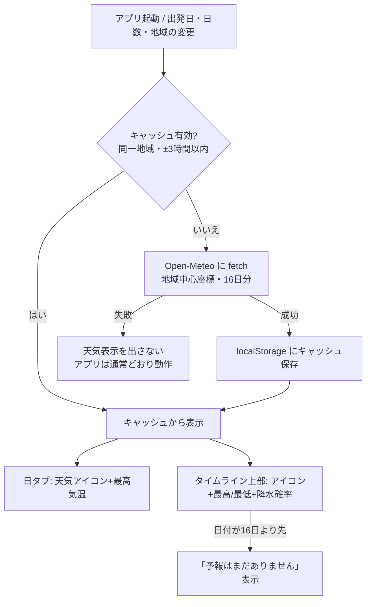

# 旅程プランナー 新機能企画書（2026-07-12）

## 1. 前提の整理

- **目的**: 個人（作者本人）の国内旅行計画づくりを、より実用的・継続的に使えるものにする
- **ターゲット**: 作者本人のみ。ユーザー登録・課金・共有アカウントは不要
- **解決する不便（現状の弱点）**:
  - 計画時に「その日の天気」が分からず、屋外/屋内スポットの判断ができない
  - 計画が1つしか持てない（次の旅行を計画すると前の旅行が消える）
  - localStorage のみのため、ブラウザのデータ消去や PC 移行で計画が全部消える
  - 旅行当日にスマホで見る・紙で持ち歩く手段が弱い
- **維持する制約**:
  - 静的Webアプリ（ビルド不要）、データ保存は localStorage のみ、サーバー・DBなし
  - 有料API・クラウドの新規契約なし（Google Maps は既存の無料枠内利用を継続）
  - 既存の残課題（APIキー分離・レスポンシブ・モジュール分割）は本企画のスコープ外

### 現状機能の要約（README・コードより）

地域選択／Places検索／カスタムスポット追加／日程タイムライン（DnD並び替え・AIおすすめ順・時刻自動計算）／移動手段と費用／ホテル選択／出発地からの経路と交通費／費用合計／地図（Google Maps or Leaflet）／localStorage 自動保存（単一の状態 `travel-planner-v1`）。

---

## 2. 新機能候補リスト

### A. 日程への天気予報表示（Open-Meteo 連携）

| 項目 | 内容 |
|---|---|
| 概要 | 各日のタブ・タイムライン見出しに、その日のその地域の天気（アイコン・最高/最低気温・降水確率）を表示 |
| ユーザー価値 | **高**。屋外スポット（庭園・展望台）と屋内（美術館・グルメ）の配分を天気で決められる。旅行計画の意思決定に直結 |
| 実装規模 | **小**（fetch 1本＋表示＋キャッシュ。既存構造への変更ほぼなし） |
| 実現方式 | Open-Meteo Forecast API。**キー不要・無料（非商用 1日1万コール）・CORS対応**で静的ページから直接 fetch 可能。最大16日先まで取得可。結果は localStorage にキャッシュ |
| リスク | 16日より先の日付は予報が出ない（「予報なし」表示で回避）。外部サービス停止時は非表示にフォールバック。個人利用なので商用条件にも抵触しない |

### B. 複数旅行プランの保存・切り替え

| 項目 | 内容 |
|---|---|
| 概要 | 「京都2月」「札幌5月」のように計画を複数保存し、ヘッダーから切り替え・複製・削除できる |
| ユーザー価値 | **高**。現状は次の旅行を計画すると前の計画が消える。過去の旅の記録・再利用（同じ地域の2回目）もできる |
| 実装規模 | **中**（保存構造を `{ plans: {...}, activePlanId }` に変更。既存データからの移行処理と、リセット/地域変更まわりの回帰確認が必要） |
| 実現方式 | localStorage 内で複数プランを持つ。既存キー `travel-planner-v1` を初回起動時に「プラン1」として自動移行 |
| リスク | 状態構造の変更が広範囲に波及（保存・復元・リセット処理）。移行バグで既存計画を壊すリスク → 移行前に旧キーを別名で温存する設計で回避 |

### C. 計画のエクスポート／インポート（JSONバックアップ）

| 項目 | 内容 |
|---|---|
| 概要 | 計画をJSONファイルとしてダウンロード・読み込み。バックアップとPC間移動用 |
| ユーザー価値 | **高**。localStorage は「ブラウザ履歴の消去」「別ブラウザ・別PC」で消える/見えない。個人利用でデータが本体に1つしかない以上、消失対策は実質必須 |
| 実装規模 | **小**（Blob ダウンロード＋ file input 読み込み＋バリデーション） |
| 実現方式 | `JSON.stringify(state)` → Blob → `<a download>`。読み込みは既存 `loadState()` の補完ロジックを流用して検証 |
| リスク | 不正なJSONの読み込みで状態が壊れる → 読み込み前に現在の状態を退避し、検証NGなら中断 |

### D. 持ち物チェックリスト

| 項目 | 内容 |
|---|---|
| 概要 | 旅行ごとの持ち物リスト（テンプレート＋自由追加、チェックボックス） |
| ユーザー価値 | 中。旅行前日の定番ニーズだが、メモアプリでも代替可能 |
| 実装規模 | **小**（リストUI＋localStorage） |
| 実現方式 | プランの状態に `packingList: [{ name, checked }]` を追加。日数・宿泊有無から初期テンプレを提案（例: 宿泊ありなら着替え） |
| リスク | ほぼなし |

### E. 旅のしおり印刷ビュー

| 項目 | 内容 |
|---|---|
| 概要 | 日程・時刻・移動・宿・費用を1〜2枚に整形した印刷用ページ（ブラウザの印刷→PDF保存でも可） |
| ユーザー価値 | 中〜高。旅行中の参照手段（紙・スマホのPDF）ができる。ネット圏外でも見られる |
| 実装規模 | **小〜中**（print用CSS＋しおり用レイアウト生成。地図の印刷は割り切りが必要） |
| 実現方式 | `@media print` ＋しおり表示モード。追加ライブラリ不要 |
| リスク | 地図はそのまま印刷しにくい（タイル画像の解像度・著作権表記）→ 初版は地図なし・テキスト中心で割り切る |

### F. 【README構想①】ホテル実データ連携（楽天トラベルAPI）

| 項目 | 内容 |
|---|---|
| 概要 | ホテルタブのサンプルデータを、楽天トラベルの実在ホテル（実勢価格・空室）に置き換え |
| ユーザー価値 | **高**。現状のホテルはサンプル＋手動編集で、実用上いちばん現実と乖離している部分 |
| 実装規模 | **中**（検索API呼び出し＋既存ホテルUIへのマッピング。緯度経度検索 → 既存の地図表示にそのまま載る） |
| 実現方式 | 楽天ウェブサービス（無料、**アプリID発行のみ・課金なし**）。楽天トラベル空室検索API／施設検索APIは JSONP（callback パラメータ）に対応しており、**静的ページから直接呼べる**ことを確認済み。緯度経度＋半径で検索可 |
| リスク | (1) 無料だが「楽天IDでのアプリID発行」という新規登録が1件必要 → **要確認**。(2) アプリIDがJSに露出する（Google Maps キーと同じ既存課題の構図。無料APIなので実害は小さいがリファラー制限等の緩和策を検討）。(3) JSONPは古い方式で、レート制限（短時間の連続アクセスで一時停止）あり → デバウンス＋キャッシュで対応 |

### G. 【README構想②】訪問した場所ごとの写真・ブログ保存

| 項目 | 内容 |
|---|---|
| 概要 | 旅行後、各スポットに写真・感想メモを紐づけて記録する（旅の記録帳化） |
| ユーザー価値 | 高（計画ツール→思い出ツールへの拡張。構想Bの複数プラン保存が前提として欲しい） |
| 実装規模 | **大** |
| 実現方式 | **写真の本体は localStorage に入らない**（base64化すると数枚で5MB上限を超える）。制約内での現実解は3案: (a) テキスト感想＋写真は「ファイルパス/Googleフォト等のURLをリンクとして保存」（localStorage のみで完結・軽量版）、(b) IndexedDB を使う（ブラウザ内完結だが「保存は localStorage のみ」の制約を緩める承認が必要）、(c) File System Access API でローカルフォルダに保存（Chrome/Edge限定、毎回フォルダ許可が要る） |
| リスク | 制約（localStorageのみ）と真っ向から衝突するため、**方式の意思決定なしに着手できない**。軽量版(a)なら小規模だが価値も限定的 |

### H. 【README構想③】写真・動画と位置情報からのムービー生成

| 項目 | 内容 |
|---|---|
| 概要 | 旅行後の写真＋ルートから、地図アニメーション付きのダイジェスト動画を生成 |
| ユーザー価値 | 中（あれば嬉しいが利用頻度は低い。Gが完成していることが前提） |
| 実装規模 | **大**（Canvas描画＋MediaRecorder でWebM出力。技術的にはブラウザ内で可能＝サーバー・GPU不要だが、演出・音声・エンコード品質の作り込みが重い） |
| 実現方式 | Canvas に地図タイル＋写真をアニメーション描画 → `canvas.captureStream()` ＋ MediaRecorder で WebM 録画。追加契約不要 |
| リスク | Gの写真保存方式が未決のため着手不可。WebM形式はスマホ共有でやや不便。工数対効果が現時点では最も低い |

---

## 3. 優先順位付け（価値 × 実装コスト）

```
価値
 高 │  C(バックアップ)   B(複数プラン)      F(楽天ホテル)
    │  A(天気予報)
 中 │  D(持ち物)  E(しおり印刷)                G(写真保存)
 低 │                                          H(ムービー)
    └──────────────────────────────────────────
        小                 中                  大   実装コスト
```

### MoSCoW

| 区分 | 機能 |
|---|---|
| **Must**（今回やる） | A. 天気予報表示 |
| **Should**（次にやる） | C. JSONエクスポート/インポート → B. 複数プラン保存（C→Bの順。Bの状態構造変更前にバックアップ手段を持つのが安全） |
| **Could**（余裕があれば） | F. 楽天トラベルAPI（アプリID登録の承認が取れたら）、D. 持ち物リスト、E. しおり印刷 |
| **Won't**（今回はやらない） | G. 写真・ブログ保存（保存方式の意思決定待ち）、H. ムービー生成（Gの完成待ち） |

### 推奨トップ3と理由

1. **A. 天気予報表示（Open-Meteo）** — 価値が高く実装が最小。キー不要・無料・CORS対応で「静的＋localStorage＋契約なし」の制約に完全適合。単独で完結しリスクがほぼない
2. **C. JSONエクスポート/インポート** — localStorage 一本のデータ消失リスクへの保険。実装が小さく、次のB（状態構造の大変更）の安全網にもなるため、Bより先に入れる
3. **B. 複数旅行プランの保存・切り替え** — 「前の計画が消える」という現状最大の構造的不満を解消。過去の旅の記録を残す文化ができ、将来のG（写真・ブログ保存）の土台にもなる

READMEの3構想については、①楽天トラベル連携は「無料・静的ページから呼べる」と確認できたので Could（登録1件の承認待ち）、②写真保存と③ムービー生成は localStorage 制約と衝突するため方式決定を先に行う、が結論。

---

## 4. 推奨トップ1「天気予報表示」詳細仕様

### 4.1 概要

計画中の各日について、行き先地域の天気予報（天気・最高/最低気温・降水確率）を日タブとタイムライン上部に表示する。データ元は Open-Meteo Forecast API（キー不要・無料）。

### 4.2 画面フロー（変更点のみ）



既存フローへの影響: なし（表示の追加のみ。並び替え・時刻計算・費用計算には一切触らない）。

### 4.3 UI要件

1. **日タブ**（`#day-tabs` の各タブ内）: 天気絵文字＋最高気温を小さく追記。例: `1日目 2/14 ☀ 12°`
2. **タイムライン上部**（`.day-settings` 付近に1行追加）: `☀ 晴れ 最高12° / 最低3°　降水確率10%`。ツールチップ（title属性）に「Open-Meteoによる予報・取得時刻」を表示
3. **予報範囲外**（出発日が16日より先）: タブは天気なし、タイムライン上部に「この日の予報はまだありません（2週間前から表示されます）」
4. **取得失敗時**（オフライン・API停止）: 天気UIを丸ごと非表示。エラーダイアログは出さない（スナックバーも不要）
5. 雨（降水確率50%以上）の日は降水確率を強調表示（例: 青太字）。「屋内スポット多めが安心」等の提案文までは今回やらない

### 4.4 データ・API仕様

- エンドポイント（キー不要・HTTPS・CORS可）:
  ```
  https://api.open-meteo.com/v1/forecast
    ?latitude={lat}&longitude={lng}
    &daily=weather_code,temperature_2m_max,temperature_2m_min,precipitation_probability_max
    &timezone=Asia%2FTokyo&forecast_days=16
  ```
- **座標の決め方**: その地域のスポット（`SPOT_DATA[region]`）の緯度経度の平均値を地域中心とする。日程にスポットが入っている日は「その日の最初のスポットの座標」を優先してもよいが、初版は地域中心固定で十分（同一地域内の予報差は小さい）
- **weather_code → 表示のマッピング**（WMOコード）: 0=快晴☀ / 1-2=晴れ時々曇り🌤 / 3=曇り☁ / 45,48=霧🌫 / 51-67,80-82=雨🌧 / 71-77,85-86=雪🌨 / 95-99=雷雨⛈。この対応表は定数として `data.js` か新設の小関数に置く
- **キャッシュ**: `travel-planner-weather-v1` キーに `{ region, lat, lng, fetchedAt, daily: {...} }` を保存。有効期限3時間。地域変更時はキー不一致として再取得
- 呼び出しタイミング: 起動時・地域変更時・出発日/日数変更時（キャッシュ有効なら fetch しない）。1日1万コール制限に対し個人利用では余裕十分

### 4.5 非機能要件

- 対応ブラウザ: 現行どおり（Windows の Chrome/Edge 最新版を想定）
- オフライン時もアプリ本体の全機能が動くこと（天気は付加情報。fetch 失敗で他機能を巻き込まない）
- 追加ライブラリなし。`js/weather.js` を新設して `index.html` から読み込む形を推奨（既存 app.js の肥大化を避ける。ただしモジュール分割方針は残課題側の判断に従う）
- 状態（`state`）には天気を保存しない（キャッシュは別キー）。既存のセーブデータ形式を変えない

### 4.6 テスト観点（QA向け）

- 出発日が今日/16日後/17日後の3パターンで表示が正しいこと
- 地域変更・日数変更で天気が追従すること
- fetch を止めた状態（DevToolsでオフライン）でアプリが通常動作すること
- キャッシュ3時間の境界（fetchedAt を手で書き換えて確認）
- 既存スモークテスト（`node tests/smoke_test.js` 141件）が引き続き全件通ること

### 4.7 実装規模見積もり

小（0.5〜1日）。fetch＋マッピング＋表示2箇所＋キャッシュ＋フォールバック。

---

## 5. 要確認事項（推測で確定していない点）

1. **楽天トラベルAPI（候補F）**: 無料だが「楽天IDでのアプリID発行」という新規登録が1件必要。登録してよいか？（Fに着手する場合のみ）
2. **写真保存（候補G）の方式**: (a) リンク保存のみ（localStorage内で完結）／(b) IndexedDB 許可（「localStorageのみ」制約の緩和）／(c) File System Access API、のどれを許容するか。G/Hの企画はこの決定後に具体化する
3. **天気の座標**: 初版は「地域の中心（スポット座標の平均）」固定でよいか。日ごとの最初のスポット座標に切り替える必要が出たら次版で対応
4. B（複数プラン）実装時の旧データ移行: 移行後も旧キー `travel-planner-v1` を一定期間残す方針でよいか

## 6. 参考（実現性確認の出典）

- Open-Meteo 公式（キー不要・非商用無料・16日予報）: https://open-meteo.com/
- Open-Meteo 解説（無料枠 1日1万コール・商用条件）: https://www.issoh.co.jp/tech/details/11707/
- 楽天ウェブサービス 楽天トラベル空室検索API（JSONP対応の記載）: https://webservice.rakuten.co.jp/documentation/vacant-hotel-search
- 楽天トラベルAPIをブラウザJSから直接叩く実例: https://bubudoufu.com/rakuten-travel-ranking-api/
